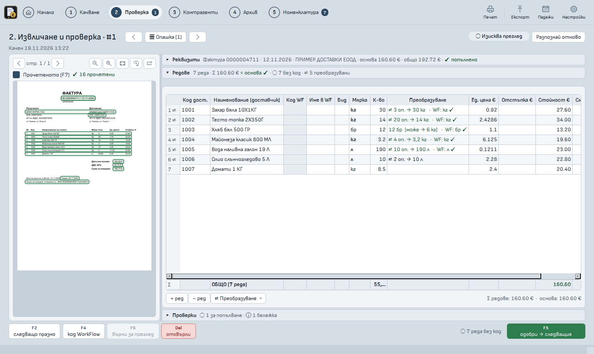
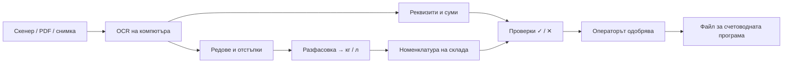
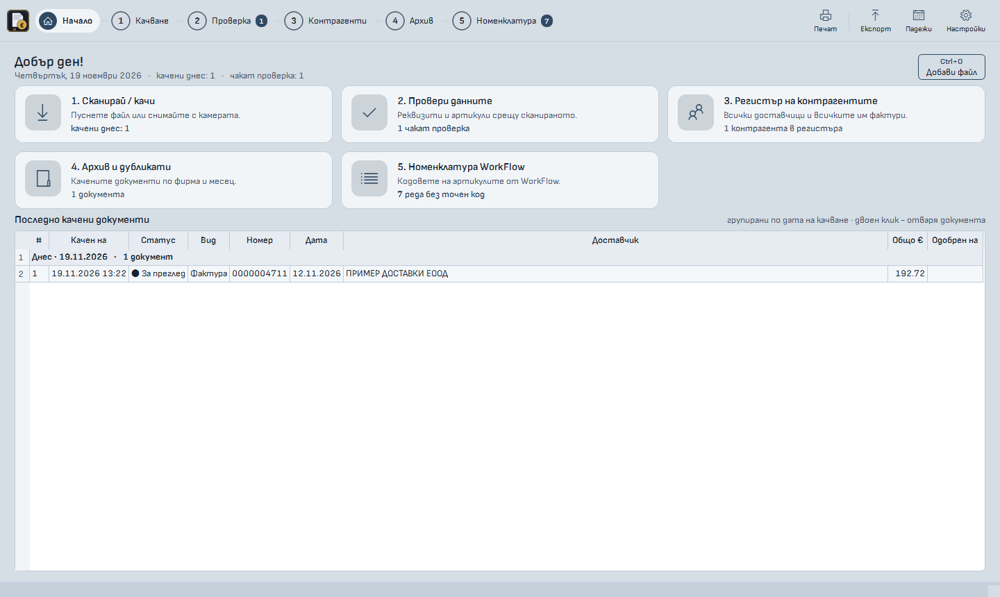
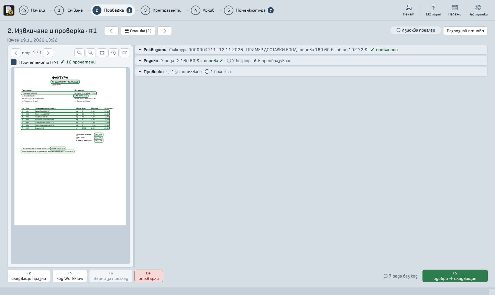
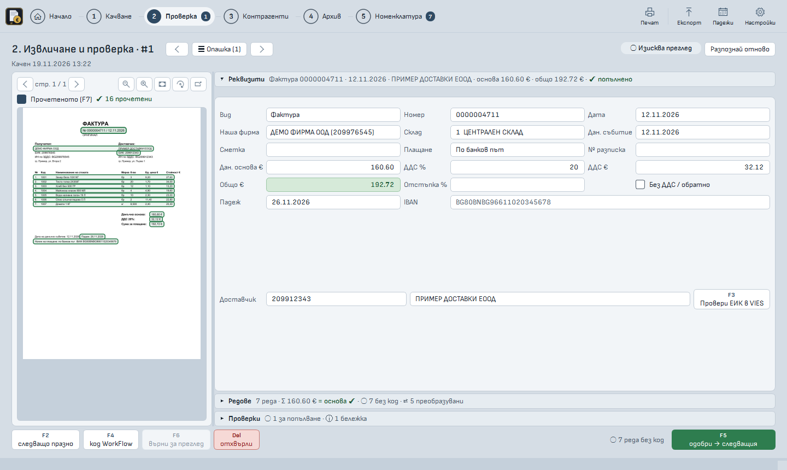
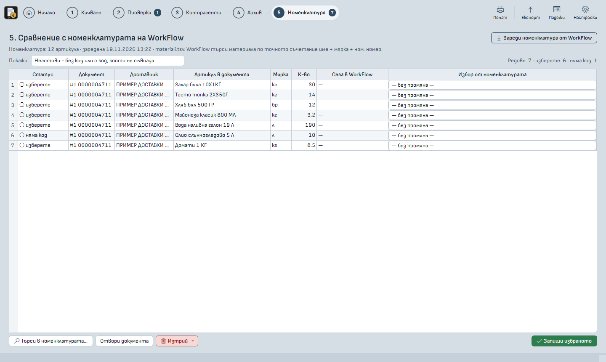

# Invoiceflow

Настолна програма за Windows, която чете фактури и складови разписки (сканирани или електронни),
проверява ги и подготвя файл за импорт в счетоводната програма. Всичко работи локално на компютъра:
без облак, без API ключове, без изпращане на документи навън.

> Това хранилище представя проекта. Изходният код не е публичен.
> Снимките са направени с измислена фактура и измислени фирми.

## Какво прави

**Разпознаване на документите**
- PDF с текст се чете директно; сканирани листове и снимки минават през OCR за кирилица, който работи
  на самия компютър: изправяне, изчистване, автоматично завъртане на листове, сканирани настрани.
- Сканиран пакет с няколко документа (фактура, приложения, следваща фактура) се разделя автоматично.
- Реквизити: вид, номер, дати, ЕИК и ДДС номер с проверка на контролната цифра, доставчик и получател,
  основа, ДДС и общо (съгласувани помежду си), падеж, IBAN със сигнал при смяна, документи в лева → евро.
- Проверка на ДДС номера в европейския регистър VIES.

**Редове (артикули)**
- Количество × цена = стойност за всеки ред; сумата на редовете се сверява с данъчната основа.
- Отстъпки, отпечатани на отделен ред под артикула, се приспадат от него.
- Устойчивост на слаб и изкривен печат: типичните грешки при разчитане се поправят автоматично.
- Специални правила за често срещани формати на доставчици.

**Мерни единици: бр ↔ кг / л**
- Разфасовката се чете от наименованието: „2Х350Г“ → 0,7 кг, „5 Л“ → 5 л, „10Х1КГ“ → 10 кг.
- Дали да има превръщане, решава номенклатурата на склада (в каква мярка се води най-близкият артикул).
- Колона „Преобразуване“ показва какво е превърнато и дали мярката съвпада със склада (✓ / ✕);
  операторът решава с двоен клик или за всички редове наведнъж.
- Изборът се запомня за доставчика и артикула.

**Работа с програмата**
- Екран „Проверка“: опашка по дата на качване, скан с рамки „откъде е прочетена всяка стойност“,
  реквизити, редове и проверки като свиващи се раздели с кратко резюме, функционални клавиши.
- Съпоставяне с номенклатурата на склада със статус „готов“.
- Файл за импорт в счетоводната програма + ръководство за настройката на импорта.
- Архив, възможни дубликати, падежи, регистър на контрагентите, печат и PDF, документна камера.

## Как работи

## Снимки

| | |
|---|---|
|  |  |
| Начален екран | „Проверка“ – разделите са свити и показват резюме |
|  |  |
| Реквизитите срещу сканираното | Съпоставяне с номенклатурата на склада |

## Технологии

Python · PyQt6 · OCR модели за кирилица (ONNX) · SQLite · PyInstaller и Inno Setup за инсталатора.

## Контакт

За демонстрация или внедряване – пишете ми в LinkedIn или в GitHub.

© 2026 Tanatos1987. Всички права запазени.
